# Architecture

PwaMote transforme un téléphone en télécommande de PC, façon Wiimote : on **vise** avec le gyroscope, on clique avec deux boutons, on tape du texte avec le clavier du téléphone.

## Vue d'ensemble

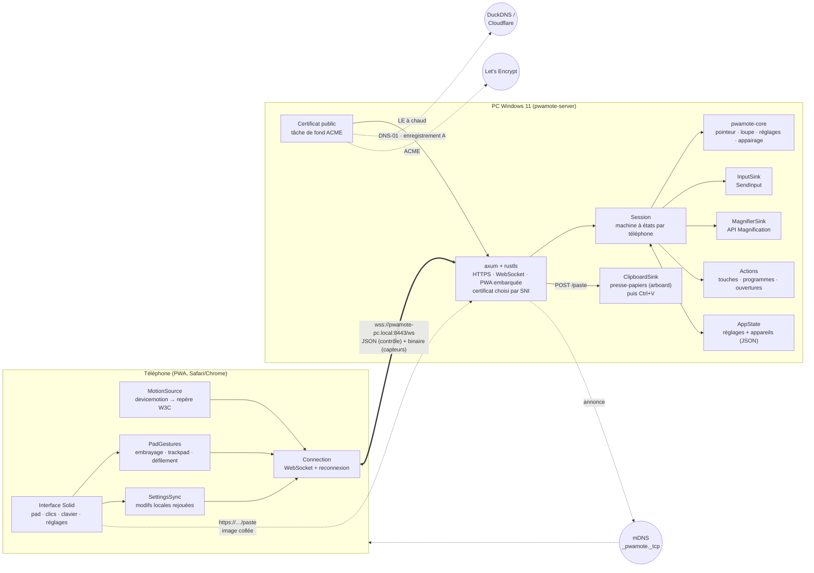

Le serveur est découpé en **cœur pur** (`pwamote-core`, testé sans OS) et **adaptateurs** (`InputSink`, `MagnifierSink`) : les tests de session tournent avec de faux adaptateurs, Windows n'est impliqué que dans la dernière couche.

## Application de bureau

L'application Windows est une coque **Tauri 2** (WebView2) autour du même serveur. La fenêtre (`desktop-ui/`, Solid) parle à Rust par des commandes ; le **superviseur** démarre, arrête et redémarre l'écoute à chaud.

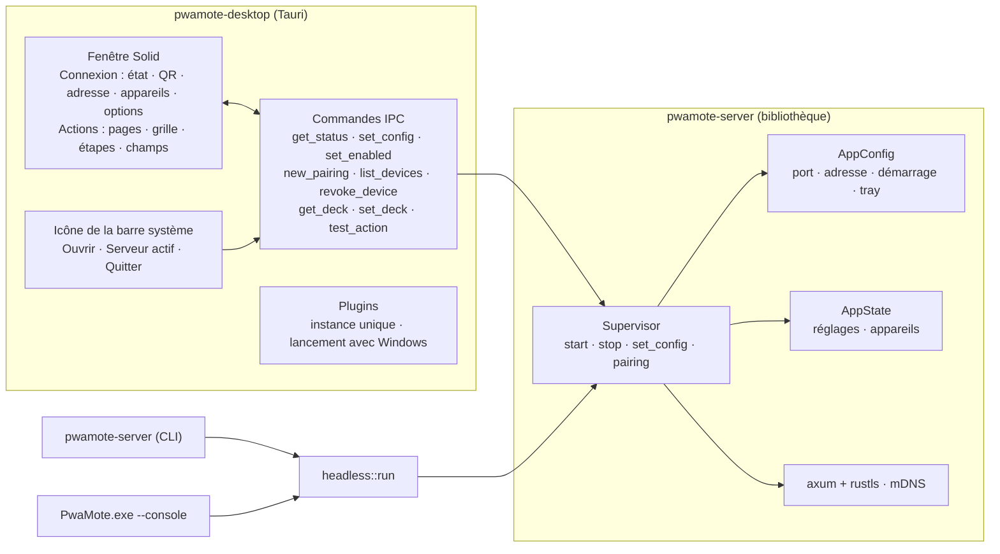

### Lancement de l'exécutable de bureau

En release, `PwaMote.exe` est compilé pour le sous-système « windows » : rien ne s'ouvre derrière la fenêtre. Les arguments sont lus par `pwamote_server::cli` (testé sans Windows) ; la console n'est demandée qu'au besoin, par `platform::windows_console`.

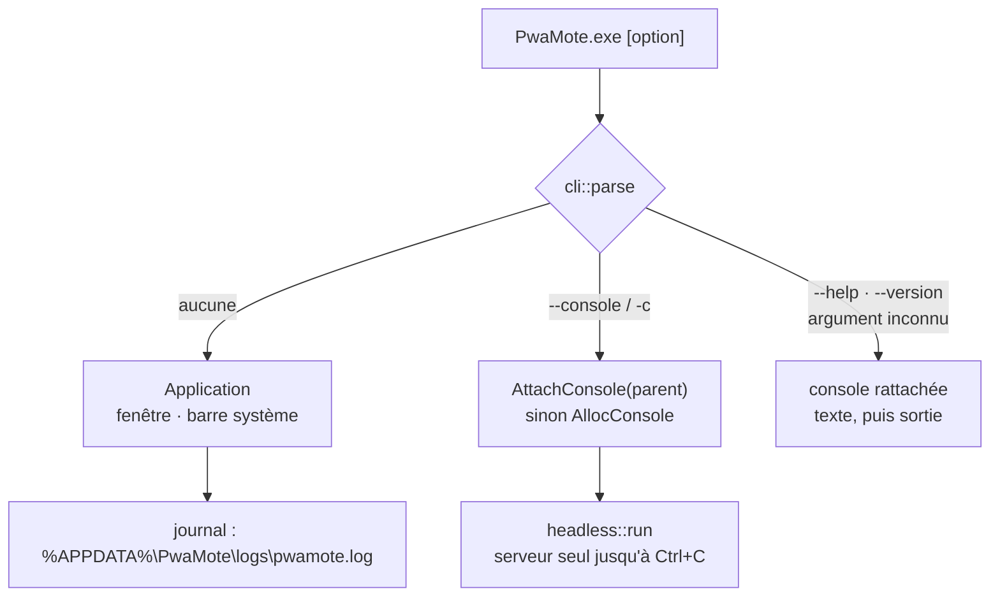

### Cycle de vie de la fenêtre

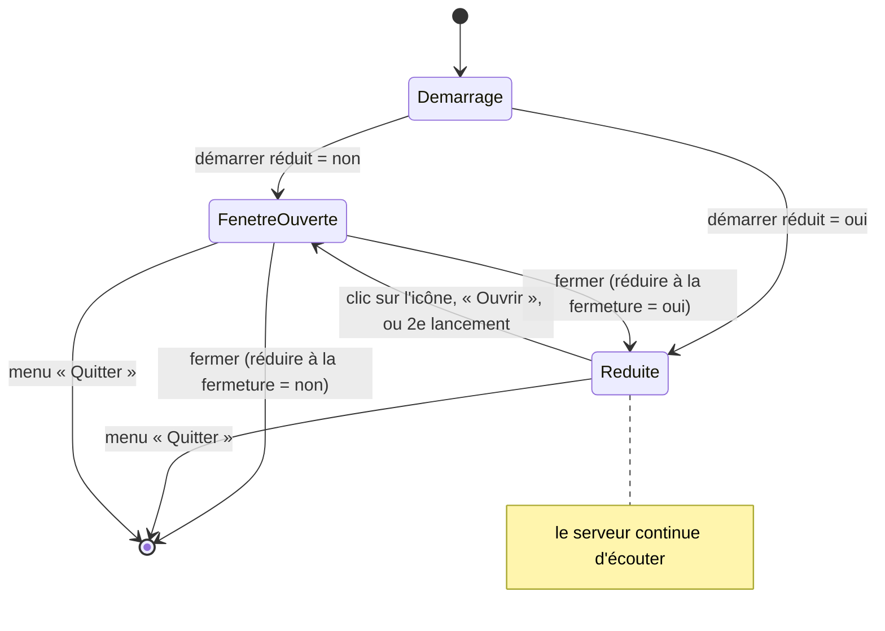

### Serveur : activer, arrêter, changer d'adresse

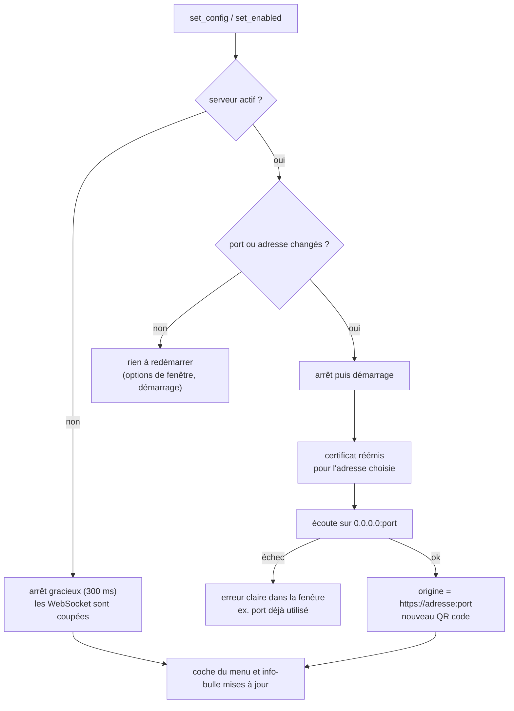

L'adresse encodée dans le QR est **au choix** : IPv4 recommandée (fonctionne partout), autre IPv4, nom `.local` (stable si l'IP change, mais dépend du mDNS), ou nom saisi (VPN, DNS interne). Le certificat couvre toujours l'adresse choisie. Les appareils restent associés par origine : changer d'adresse oblige un téléphone à se ré-appairer, car le navigateur isole ses données par origine.

## Dépôt

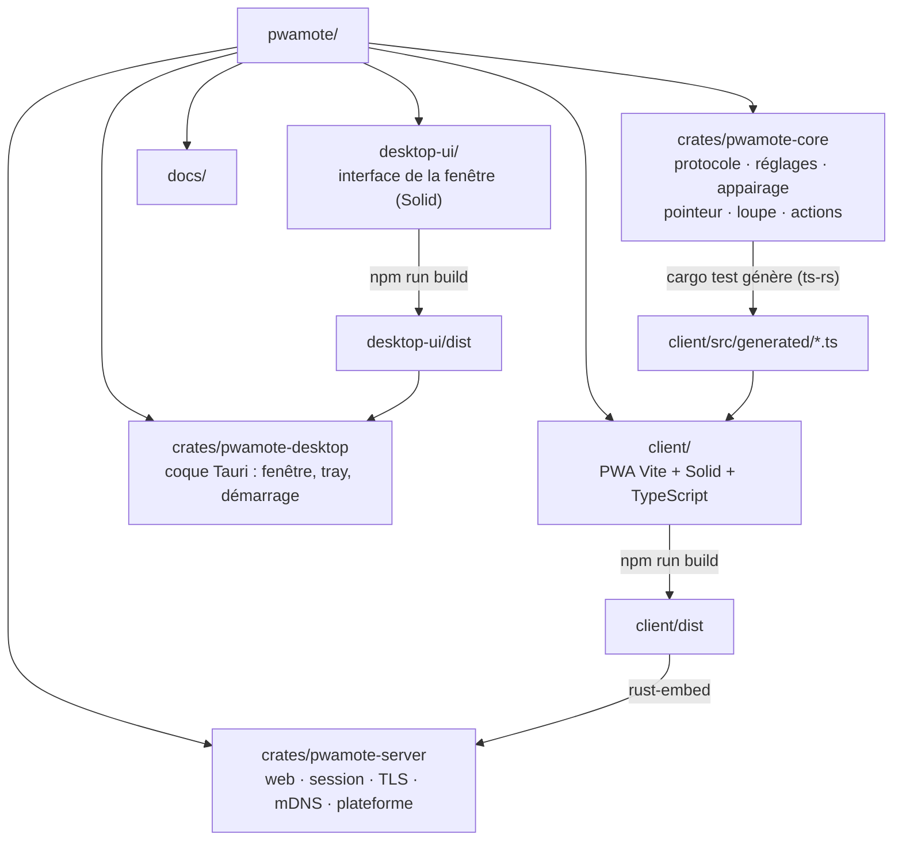

Les types du protocole sont définis **une seule fois**, en Rust. `cargo test` régénère `client/src/generated`, et la CI échoue si ces fichiers ne sont pas à jour.

## Releases

Le changelog n'est pas un fichier tenu à la main : il est calculé à chaque release à partir des messages de commit entre deux tags (Conventional Commits, voir [CONTRIBUTING.md](../CONTRIBUTING.md)). Le générateur natif de GitHub ne liste que les pull requests ; le dépôt travaillant en commits directs sur `main`, c'est [git-cliff](https://git-cliff.org) qui produit les notes, au format Markdown habituel des releases GitHub.

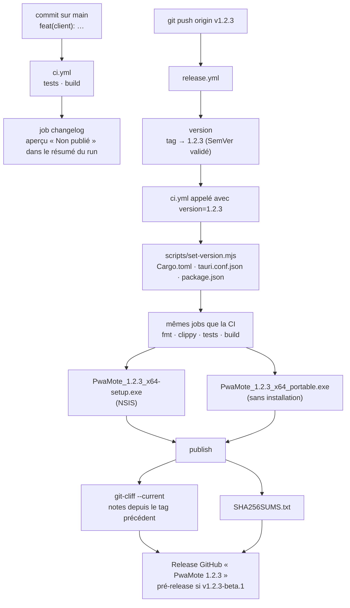

- La version n'est jamais commitée : le dépôt reste à `0.1.0` et chaque job de release l'injecte avant de compiler. Le serveur la publie via `CARGO_PKG_VERSION` (mDNS, User-Agent), la fenêtre via Tauri, la PWA dans Réglages (« Version de l'app : 1.2.3 (date) »).
- La release ne part que si toute la CI passe, avec les mêmes contrôles que sur `main`.
- Relancer le workflow d'un tag remplace les notes et les fichiers de la release existante.

### Mises à jour dans l'application de bureau

La fenêtre affiche sa version en petit à côté du titre et, s'il en existe une plus récente, une pastille « Mise à jour 1.3.0 » qui ouvre la page de la release. Le menu de la barre système montre la même information sur sa première ligne.

Seuls les binaires publiés par la CI de release vérifient les mises à jour. Le workflow définit `PWAMOTE_RELEASE_REPO` (le dépôt qui publie, `wardensfx/pwamote`) au moment de compiler ; le binaire le lit avec `option_env!`. Sans cette variable, c'est-à-dire pour quiconque compile le code lui-même ou pour la CI ordinaire de `main`, rien n'est vérifié et GitHub n'est jamais contacté : la fenêtre affiche alors `v0.1.0 · dev`.

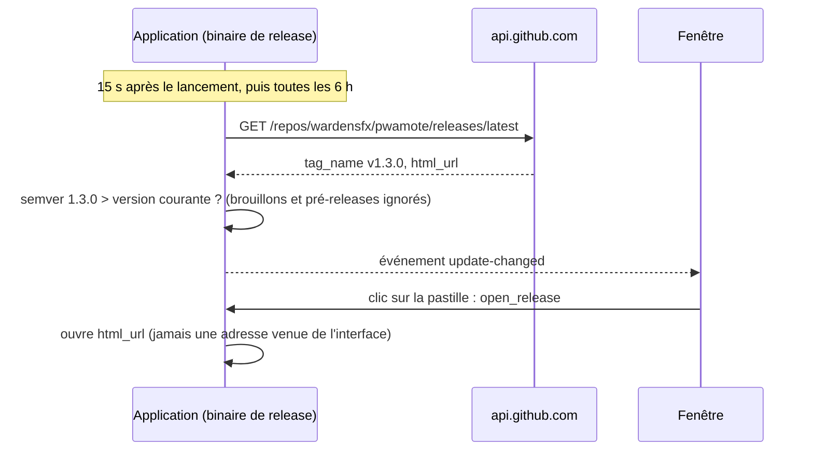

- Hors ligne ou limite de l'API atteinte (60 requêtes par heure et par IP sans authentification) : l'échec est ignoré et la vérification suivante a lieu six heures plus tard.
- Une installation en `1.3.0-beta.2` se voit proposer `1.3.0` dès sa sortie ; les pré-releases elles-mêmes ne sont jamais proposées.
- Il n'y a pas d'installation automatique : la pastille mène à la page de la release, avec les notes et l'installeur.

## Appairage

Un code à usage unique (5 min) est encodé dans un QR affiché sur le PC, à l'adresse `https://localhost:8443/admin/pair` (réservée à la machine). Seul l'empreinte SHA-256 du jeton d'appareil est stockée.

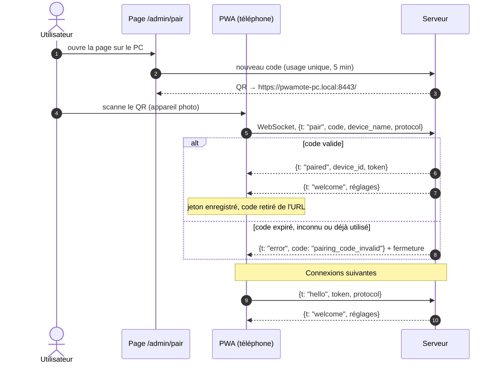

## HTTPS : Let's Encrypt, avec repli sur l'autorité locale

Safari n'expose le gyroscope et ne permet l'installation hors-ligne qu'en HTTPS. Objectif : **on lance, ça marche**, sans rien installer sur l'iPhone. Or Let's Encrypt ne signe que des **noms de domaine publics** (ni IP, ni `.local`), et iOS n'accepte une autorité locale qu'après installation manuelle d'un profil (règle d'Apple ; Caddy n'y échappe que parce que le navigateur tourne sur le même PC). D'où le modèle de `plex.direct` :

| Mode | Nom servi | Réglage | iPhone |
|---|---|---|---|
| **Automatique** (par défaut) | `<id>.d.pwamote.app`, attribué par le [service DNS PwaMote](../relay/README.md) | aucun | rien à installer |
| Mon domaine | `pc.mondomaine.fr` (Cloudflare) ou `xxx.duckdns.org` | domaine + jeton | rien à installer |
| Local seul | IP, `pwamote-<machine>.local` | aucun | profil à installer une fois |

Dans les deux premiers modes, le nom pointe vers l'**IP locale** du PC et le certificat est obtenu par le **défi DNS-01** : le PC n'a jamais besoin d'être joignable depuis internet. L'**autorité locale** reste toujours en place pour l'IP, le `.local` et le repli hors-ligne ; son certificat est **conservé d'un lancement à l'autre** (une exception acceptée dans Safari reste valable).

L'identifiant est aléatoire (12 caractères, `k3x9f2ab7qzm`) et ne contient pas le nom du PC : chaque certificat Let's Encrypt est publié dans les journaux publics *Certificate Transparency*.

### Mode automatique : inscription et publication

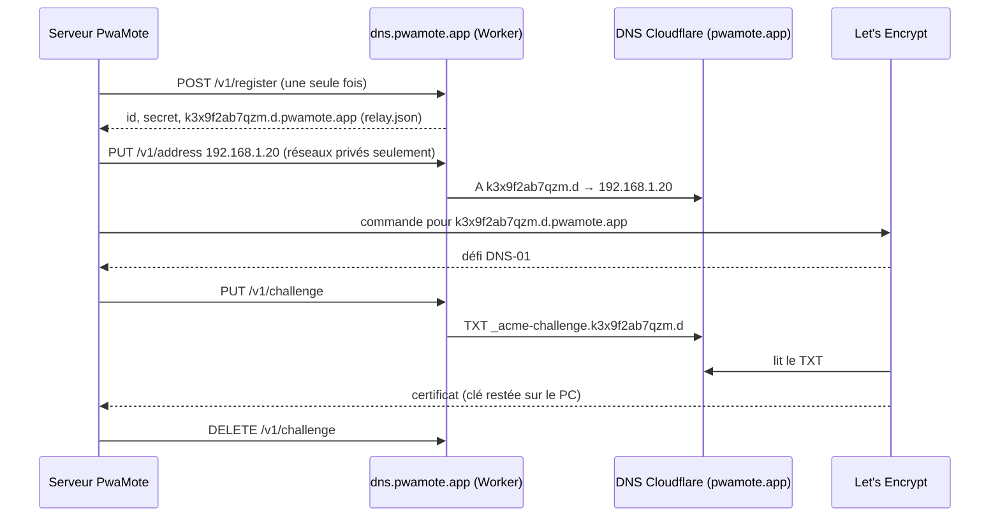

Le service ne voit jamais la clé privée ni le trafic. Il refuse toute adresse publique : un nom `pwamote.app` ne peut pas servir à imiter un site sur internet.

### Choix du certificat à chaque connexion

Le serveur lit le nom demandé par le téléphone (SNI) : les deux certificats sont servis **en même temps**, sans redémarrage quand Let's Encrypt en délivre un nouveau.

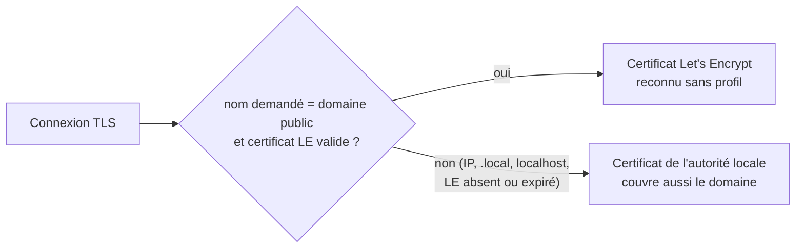

Le **QR code** encode le domaine public dès qu'un certificat Let's Encrypt valide est chargé, sinon l'adresse locale choisie. Les téléphones déjà associés par IP continuent de fonctionner (même origine, même certificat local). Un téléphone qui passe de l'IP au domaine change d'origine : il faut le ré-associer une fois (le navigateur isole ses données par origine).

### Tâche de fond : connexion, échéance, renouvellement

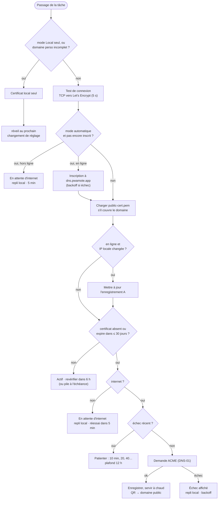

Un changement de réglage réveille la tâche immédiatement. Au démarrage sans internet, un certificat Let's Encrypt encore valide est rechargé depuis le disque et servi tout de suite (TLS ne demande pas internet). Les fichiers de test (serveur *staging*) sont séparés de ceux de production.

### Défi DNS-01

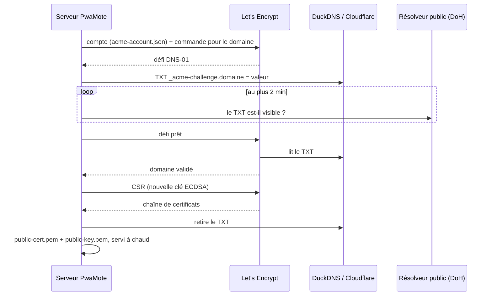

### Ce qu'il faut savoir

- **Le téléphone doit résoudre le domaine** via le DNS public : il faut internet sur le réseau du téléphone. Sans internet, il reste l'IP et le certificat local.
- **Protection anti-rebinding** : quelques box ou bloqueurs DNS (Pi-hole, certains routeurs) refusent un nom public qui pointe vers une IP privée. Il faut alors autoriser le domaine dans leur configuration, ou rester sur l'IP.
- **Jetons (mode Mon domaine)** : stockés en clair dans `config.json` (`%APPDATA%\PwaMote`), comme le reste de la configuration. Préférer un jeton Cloudflare limité à une seule zone.
- **Limites Let's Encrypt** : 5 échecs de validation par heure et par domaine ; d'où le backoff, et la case « serveur de test » pour essayer. En mode automatique, 50 nouveaux certificats par semaine pour tout `pwamote.app` (renouvellements exclus) ; au-delà, Public Suffix List (voir `relay/README.md`).

### Premier lancement sans Let's Encrypt (autorité locale)

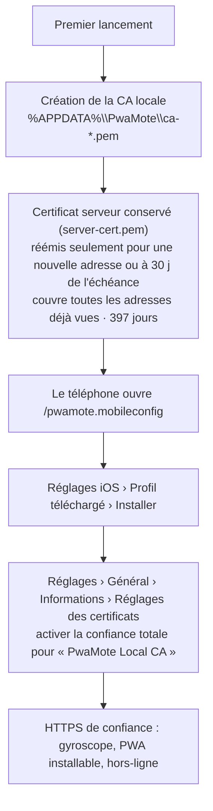

## Du gyroscope au curseur

Le moteur (`pointer.rs`) ne dépend pas de la façon dont on tient le téléphone : la vitesse angulaire est projetée sur la **verticale réelle** (gravité) et sur l'axe horizontal du téléphone.

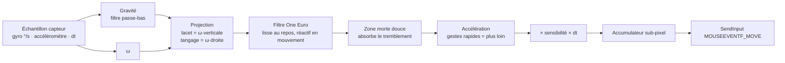

### Côté téléphone : d'où viennent ω et la gravité

Les navigateurs ne s'accordent pas sur l'ordre des axes de `rotationRate`. Le client calcule donc ω à partir de `deviceorientation` (alpha, beta, gamma, définis sans ambiguïté par le W3C) : l'orientation devient un quaternion, et la rotation entre deux événements, exprimée dans le repère du téléphone, donne la vitesse angulaire. La gravité vient du même calcul, ce qui garantit qu'elle reste cohérente avec ω. `rotationRate` (avec calibration des axes) ne sert que de repli si aucun événement d'orientation n'arrive.

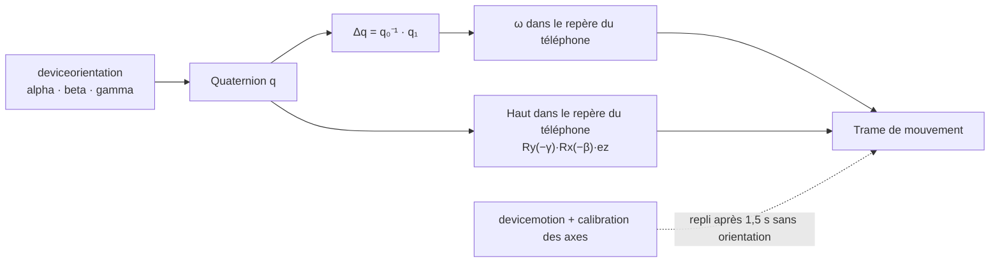

### Embrayage

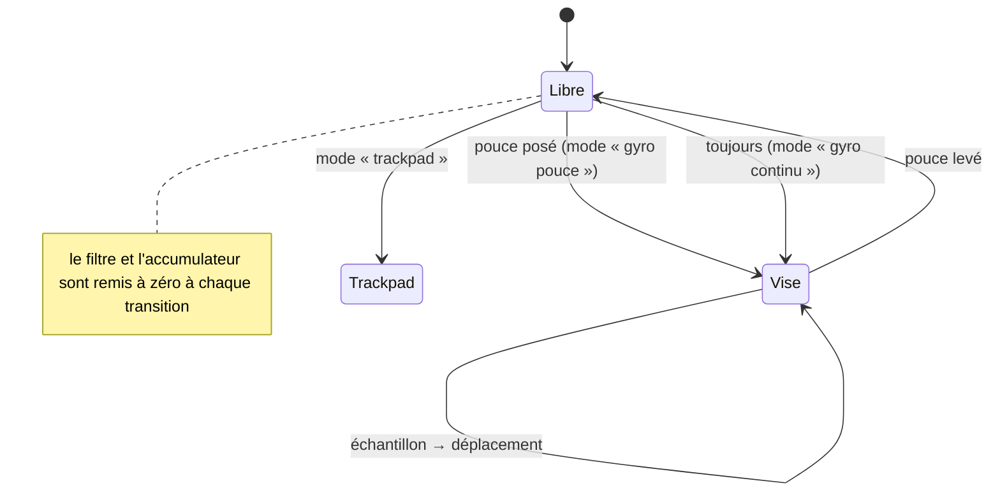

### La surface centrale selon le mode

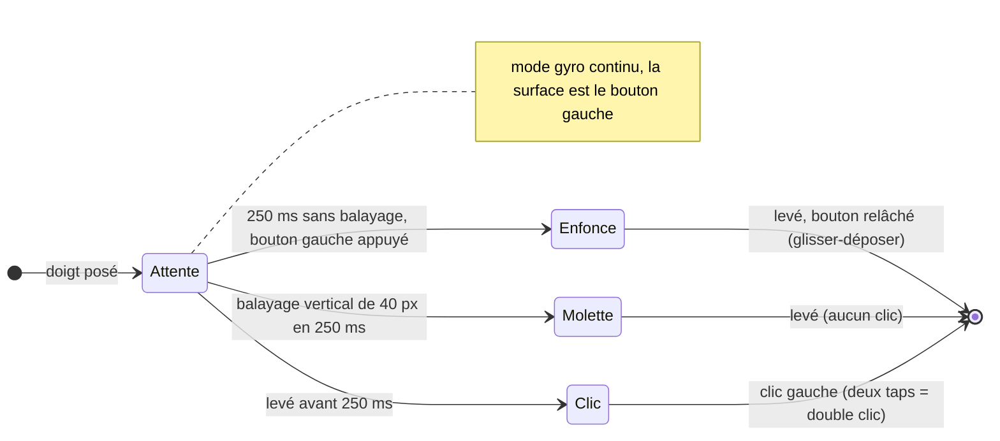

| Mode | 1 doigt posé | Tap | Balayage vertical rapide | 2 doigts |
|---|---|---|---|---|
| Gyro (pouce) | embraye le pointage | clic gauche | molette, curseur figé | molette |
| Gyro continu | après 250 ms : bouton gauche maintenu | clic gauche | molette, sans clic | molette |
| Trackpad | déplace le curseur | clic gauche | — | molette |

Le délai de 250 ms avant d'enfoncer le bouton laisse le temps de reconnaître un balayage : sans lui, chaque défilement commencerait par un clic.

## Réglages synchronisés

Le **serveur est la source de vérité**. Les modifications du téléphone sont des fonctions rejouées par-dessus la dernière version reçue : si deux téléphones changent deux réglages différents en même temps, les deux changements sont conservés.

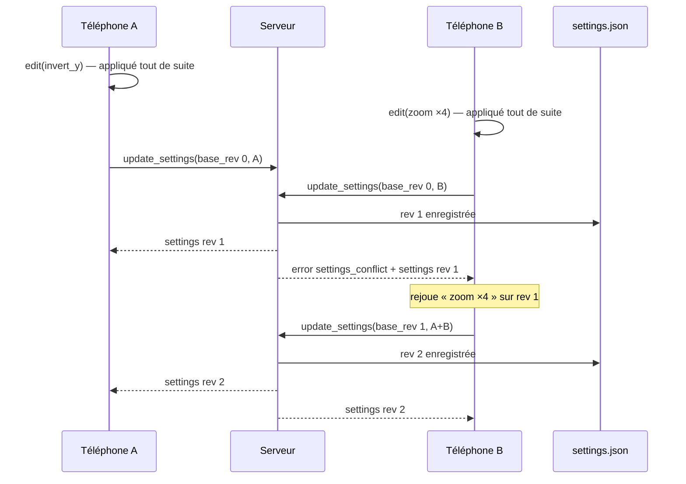

Les réglages sont validés et ramenés dans des plages sûres côté serveur (`Settings::sanitized`) : valeurs non finies remplacées par les valeurs par défaut.

## Protocole

| Direction | Canal | Contenu |
|---|---|---|
| téléphone → PC | JSON | `hello`, `pair`, `button`, `key_tap`, `key`, `modifier`, `text`, `clutch`, `recenter`, `magnifier`, `update_settings`, `run_action`, `ping` |
| téléphone → PC | binaire | `0x01` mouvement (7 × f32), `0x02` trackpad (2 × f32), `0x03` défilement (2 × f32), `0x04` accélération linéaire pour l'option « déplacements du téléphone » (4 × f32), little-endian |
| PC → téléphone | JSON | `paired`, `welcome`, `deck`, `settings`, `magnifier_state`, `action_result`, `error`, `pong` |
| téléphone → PC | HTTPS `POST /paste` | image (ou texte) brute collée dans le champ du clavier, jeton d'appareil en `Authorization: Bearer` ; le PC la colle avec Ctrl+V |

Garanties de sécurité côté serveur :

- aucune commande n'est exécutée avant `hello` ou `pair` réussi ;
- un clic, une touche ou un modificateur maintenu est **relâché** quand le téléphone se déconnecte ;
- les doubles « appui » sont ignorés (seules les vraies transitions partent) ;
- taille de message limitée à 64 Ko, trames binaires invalides ignorées.

## Coller une image depuis le téléphone

Dans le champ du clavier, un **texte** collé est tapé sur le PC comme le reste de la saisie. Une **image** collée (appui long › Coller) ne peut pas entrer dans un champ texte : elle est interceptée et **collée sur le PC**, comme si on avait fait Ctrl+V là-bas. Aucun réglage, et pas de synchronisation des presse-papiers dans un sens ou dans l'autre.

Le collage dans un champ donne accès à l'image sans la bulle « Coller » qu'iOS impose à `navigator.clipboard.read()`.

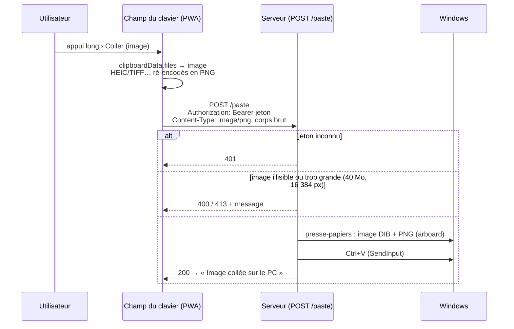

Pourquoi une requête HTTP plutôt que le WebSocket : une capture d'écran d'iPhone pèse plusieurs Mo, bien au-delà de la limite de 64 Ko des messages, et elle ne doit pas retarder les trames du gyroscope. La requête est authentifiée avec le même jeton d'appareil que la session, et le décodage tourne hors de la boucle async (`spawn_blocking`). L'image remplace le contenu du presse-papiers du PC.

## Actions programmables

Un panneau de boutons façon Stream Deck, ouvert par la pastille **Actions** du téléphone. Tout se définit dans la fenêtre du PC, onglet **Actions** : pages, taille de la grille (2 à 5 colonnes, 1 à 6 lignes), boutons (libellé, icône, couleur), étapes, et champs à demander au téléphone. Le panneau est enregistré dans `%APPDATA%\PwaMote\actions.json` ; au premier lancement, un exemple est proposé (vitesse des vidéos avec S et D, raccourcis, recherche YouTube).

```mermaid
classDiagram
  direction LR
  class Deck {
    pages
  }
  class DeckPage {
    id
    name
    columns
    rows
    cells
  }
  class ActionButton {
    id
    label
    icon
    color
  }
  class ActionInput {
    id
    label
  }
  class InputKind {
    <<enumeration>>
    choice : options, default
    slider : min, max, step, default, unit
    number : min, max, default, integer
    text : default, placeholder
    toggle : default, on, off
  }
  class ActionStep {
    <<enumeration>>
    keys : key, modifiers
    text : text
    run : program, args, cwd, hidden
    open : target
    delay : ms
  }
  Deck "1" --> "*" DeckPage
  DeckPage "1" --> "*" ActionButton : cases de la grille
  ActionButton "1" --> "0..8" ActionInput : champs demandés
  ActionInput --> InputKind
  ActionButton "1" --> "1..32" ActionStep : dans l'ordre
```

Les étapes **ne quittent jamais le PC** : le téléphone reçoit une vue (`DeckView`) avec la disposition, les libellés et les champs, sans programmes ni commandes.

```mermaid
flowchart LR
  subgraph PC["PC"]
    ED["Fenêtre · onglet Actions<br/>éditeur, essai sur le PC"] -- "set_deck (IPC Tauri)" --> ST["AppState<br/>Deck::sanitized"]
    ST --> F[("actions.json")]
    ST -- "deck.view()" --> BR["diffusion"]
  end
  BR -- "{t: deck, deck: DeckView}<br/>à l'ouverture et à chaque modification" --> PH["Téléphone<br/>panneau Actions"]
```

### Lancer une action

```mermaid
sequenceDiagram
  autonumber
  actor U as Utilisateur
  participant P as PWA
  participant S as Session (serveur)
  participant X as Exécution (thread à part)
  participant W as Windows

  U->>P: touche un bouton
  alt le bouton a des champs
    P->>U: formulaire (liste, curseur, nombre, texte, interrupteur)<br/>dernières valeurs reprises
    U->>P: Lancer
  end
  P->>S: {t: "run_action", id, values}
  S->>S: session authentifiée ?<br/>bouton défini sur le PC ?<br/>chaque valeur conforme à son champ ?
  alt refus
    S-->>P: {t: "action_result", ok: false, message}
  else plan validé
    S->>X: ActionJob (au plus 4 en même temps)
    loop chaque étape
      X->>W: SendInput (touches, texte) · CreateProcess · ShellExecute · pause
    end
    X-->>P: {t: "action_result", ok, message}
  end
  P->>U: contour vert, ou rouge et message
```

L'exécution a lieu hors de la boucle du WebSocket : une pause de 2 s dans une action ne fige pas le pointeur.

### Valeurs saisies et sécurité

```mermaid
flowchart TD
  V["Valeur reçue du téléphone"] --> K{"Champ déclaré<br/>pour ce bouton ?"}
  K -- non --> R["refus : champ inconnu"]
  K -- oui --> T{"Type du champ"}
  T -- liste --> C["une des valeurs prévues"]
  T -- curseur --> S["nombre fini, dans min…max,<br/>arrondi au pas"]
  T -- nombre --> N["nombre fini, bornes,<br/>entier si demandé"]
  T -- texte --> X["≤ 1 000 caractères,<br/>sans caractère nul"]
  T -- interrupteur --> B["booléen → valeur<br/>« activé » ou « désactivé »"]
  C & S & N & X & B --> P["{champ} remplacé dans :<br/>texte tapé · arguments · adresse à ouvrir<br/>{champ:url} encodé pour une adresse"]
  P --> G["jamais dans le programme ni dans son dossier ;<br/>chaque argument reste un argument,<br/>aucun interpréteur de commandes"]
```

- seules les actions définies dans la fenêtre du PC existent ; le téléphone ne peut ni en créer ni en modifier ;
- seul un téléphone associé (après `hello` ou `pair`) peut en lancer ;
- un champ texte libre peut contenir n'importe quoi : pour un script, passer la valeur en argument (`-File script.ps1 {champ}`) plutôt que de construire une commande ; l'éditeur avertit si une cible « Ouvrir » commence par un champ.

Les touches passent par `SendInput` avec leur code virtuel **et** leur code de balayage : pour un navigateur, c'est une vraie frappe (`KeyboardEvent.key` et `code` renseignés), ce que les extensions comme les contrôleurs de vitesse vidéo attendent. Le texte du clavier, lui, est envoyé en Unicode : parfait pour écrire, invisible pour ces raccourcis.


## Loupe intelligente

```mermaid
flowchart TD
  O["Observation à chaque image<br/>écran · curseur · caret"] --> F{"Mode"}
  F -- curseur --> PC1["point = curseur"]
  F -- saisie --> PC2["point = caret"]
  F -- intelligent --> T{"caret a bougé<br/>depuis moins de 1,5 s ?"}
  T -- oui, on tape --> PC2
  T -- non --> PC1
  PC1 --> V["Zone visible<br/>suit seulement près des bords (marge 22 %)"]
  PC2 --> V
  V --> Z["Zoom animé vers la cible<br/>entrée et sortie douces"]
  Z --> MG["MagSetFullscreenTransform"]
```

Limites connues : le caret n'est lisible que pour les applications Win32 classiques ; navigateurs et applications Electron retombent sur le curseur (UI Automation est prévue pour couvrir ces cas). La loupe agit sur l'écran principal.

## Choix techniques

| Sujet | Choix | Pourquoi |
|---|---|---|
| Client | PWA, Vite, Solid, TypeScript | iPhone sans compilation native, multiplateforme, 42 Ko de JS |
| Serveur | Rust, tokio, axum, rustls (ring) | binaire unique, faible latence, pas de dépendance C à compiler |
| Types partagés | `ts-rs` | une seule définition du protocole, vérifiée par la CI |
| Certificat public | Let's Encrypt via `instant-acme`, défi DNS-01 (DuckDNS, Cloudflare via `reqwest`), repli autorité locale (`rcgen`) | domaine public obligatoire pour LE ; DNS-01 n'exige pas d'ouvrir le PC sur internet |
| Découverte | mDNS (`mdns-sd`) + QR | un navigateur ne peut pas scanner le réseau ; le nom `.local` reste stable si l'IP change |
| Injection | `SendInput` (crate `windows`) | API officielle, texte en Unicode (accents, emoji) |
| Tests | `cargo test`, Vitest, Playwright | cœur et sessions sans OS, client avec faux WebSocket |
