# Architecture

PwaMote transforme un téléphone en télécommande de PC, façon Wiimote : on **vise** avec le gyroscope, on clique avec deux boutons, on tape du texte avec le clavier du téléphone.

## Vue d'ensemble

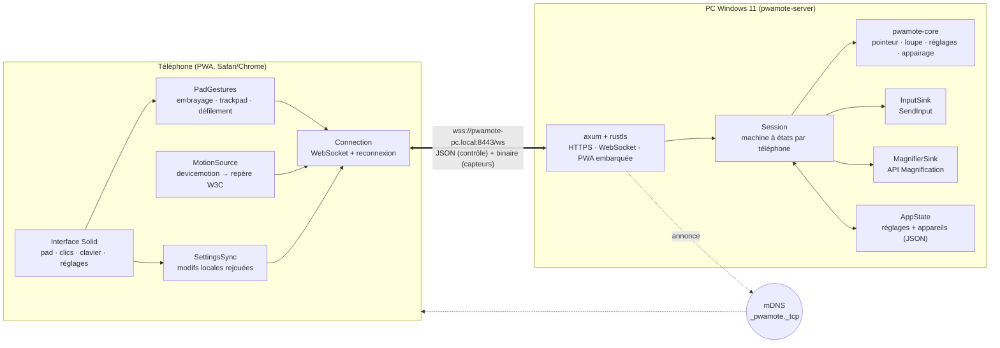

Le serveur est découpé en **cœur pur** (`pwamote-core`, testé sans OS) et **adaptateurs** (`InputSink`, `MagnifierSink`) : les tests de session tournent avec de faux adaptateurs, Windows n'est impliqué que dans la dernière couche.

## Application de bureau

L'application Windows est une coque **Tauri 2** (WebView2) autour du même serveur. La fenêtre (`desktop-ui/`, Solid) parle à Rust par des commandes ; le **superviseur** démarre, arrête et redémarre l'écoute à chaud.

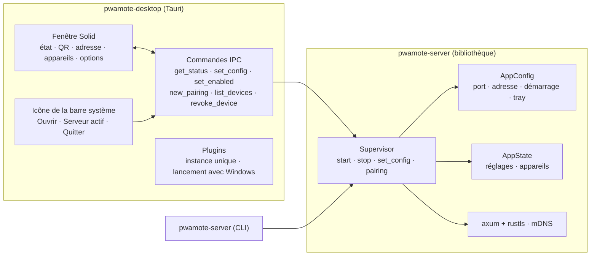

### Cycle de vie de la fenêtre

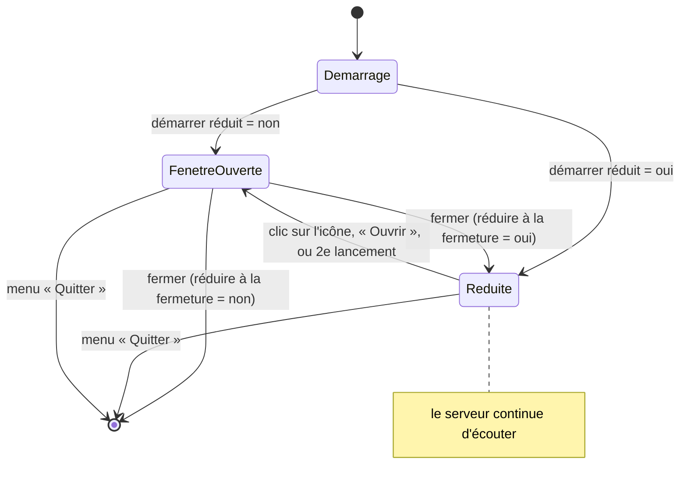

### Serveur : activer, arrêter, changer d'adresse

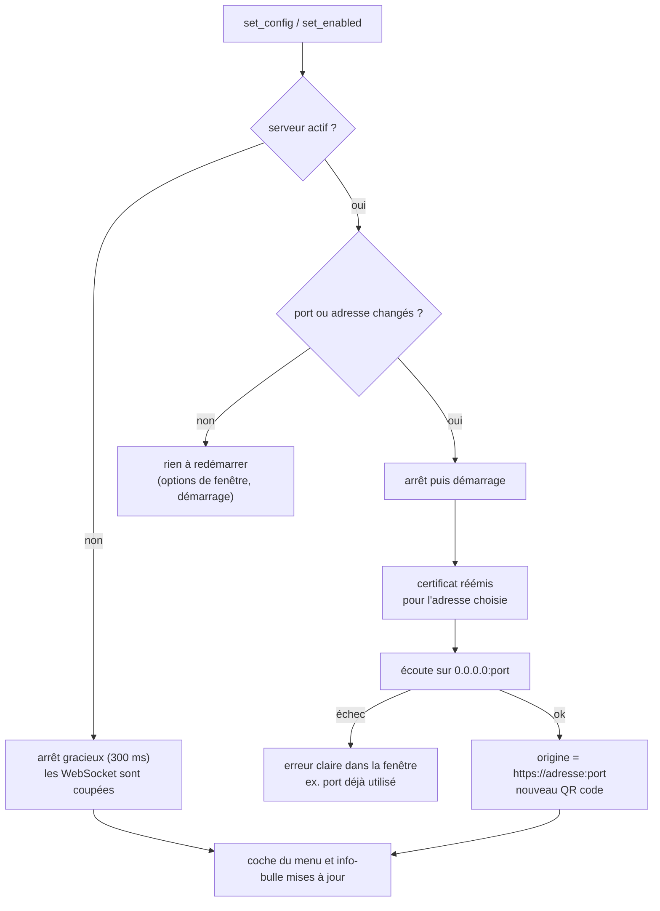

L'adresse encodée dans le QR est **au choix** : IPv4 recommandée (fonctionne partout), autre IPv4, nom `.local` (stable si l'IP change, mais dépend du mDNS), ou nom saisi (VPN, DNS interne). Le certificat couvre toujours l'adresse choisie. Les appareils restent associés par origine : changer d'adresse oblige un téléphone à se ré-appairer, car le navigateur isole ses données par origine.

## Dépôt

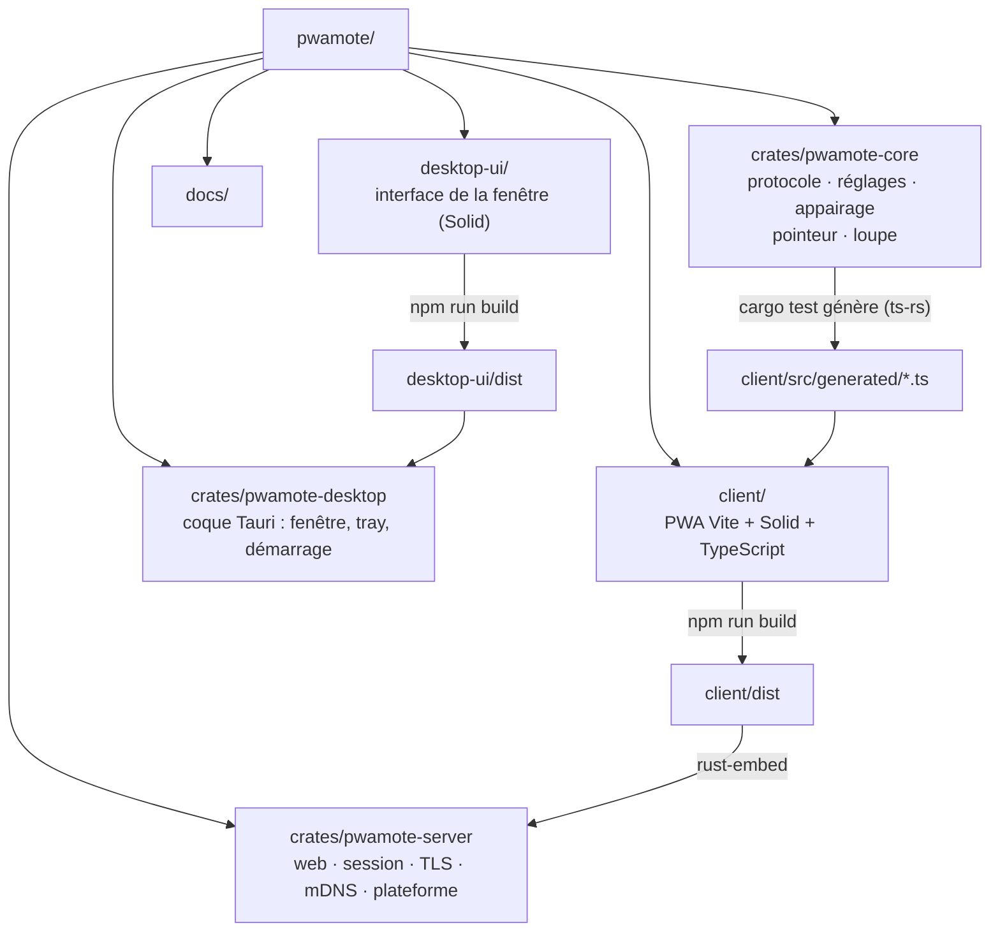

Les types du protocole sont définis **une seule fois**, en Rust. `cargo test` régénère `client/src/generated`, et la CI échoue si ces fichiers ne sont pas à jour.

## Appairage

Un code à usage unique (5 min) est encodé dans un QR affiché sur le PC, à l'adresse `https://localhost:8443/admin/pair` (réservée à la machine). Seul l'empreinte SHA-256 du jeton d'appareil est stockée.

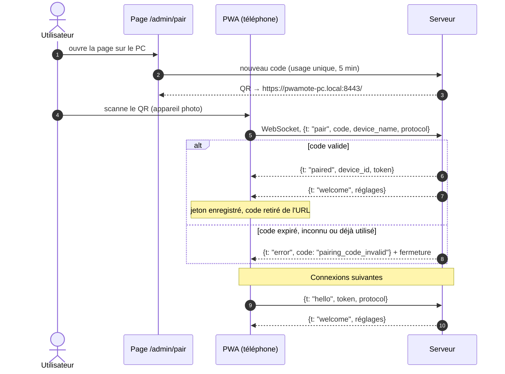

## HTTPS local

Safari n'expose le gyroscope et ne permet l'installation hors-ligne qu'en HTTPS. Le serveur crée sa propre autorité de certification une seule fois, puis émet un certificat pour `pwamote-<machine>.local` et les adresses IP du moment à chaque démarrage.

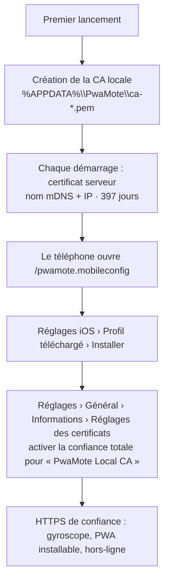

## Du gyroscope au curseur

Le moteur (`pointer.rs`) ne dépend pas de la façon dont on tient le téléphone : la vitesse angulaire est projetée sur la **verticale réelle** (gravité) et sur l'axe horizontal du téléphone.

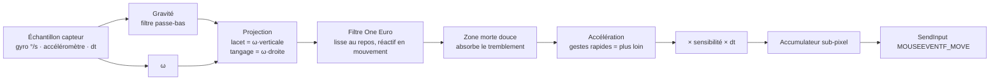

### Côté téléphone : d'où viennent ω et la gravité

Les navigateurs ne s'accordent pas sur l'ordre des axes de `rotationRate`. Le client calcule donc ω à partir de `deviceorientation` (alpha, beta, gamma, définis sans ambiguïté par le W3C) : l'orientation devient un quaternion, et la rotation entre deux événements, exprimée dans le repère du téléphone, donne la vitesse angulaire. La gravité vient du même calcul, ce qui garantit qu'elle reste cohérente avec ω. `rotationRate` (avec calibration des axes) ne sert que de repli si aucun événement d'orientation n'arrive.

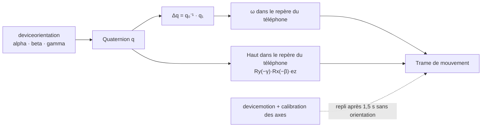

### Embrayage

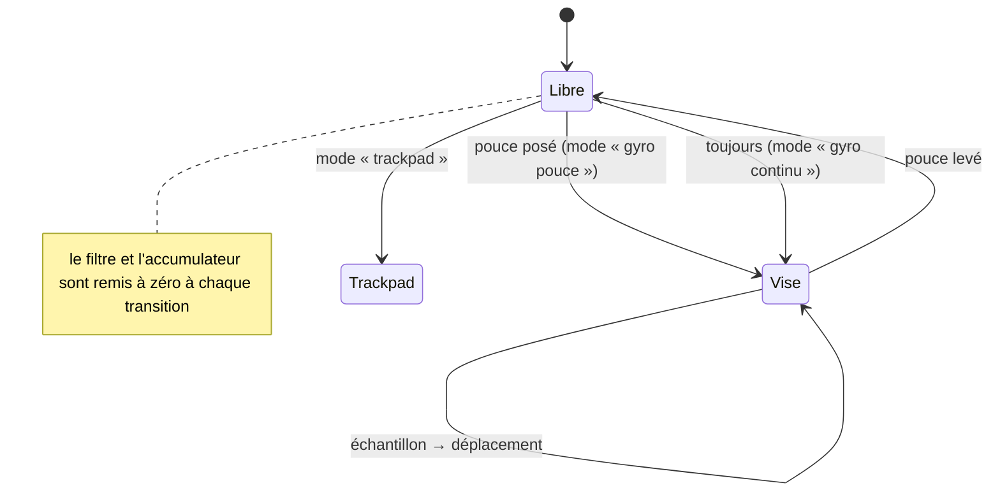

## Réglages synchronisés

Le **serveur est la source de vérité**. Les modifications du téléphone sont des fonctions rejouées par-dessus la dernière version reçue : si deux téléphones changent deux réglages différents en même temps, les deux changements sont conservés.

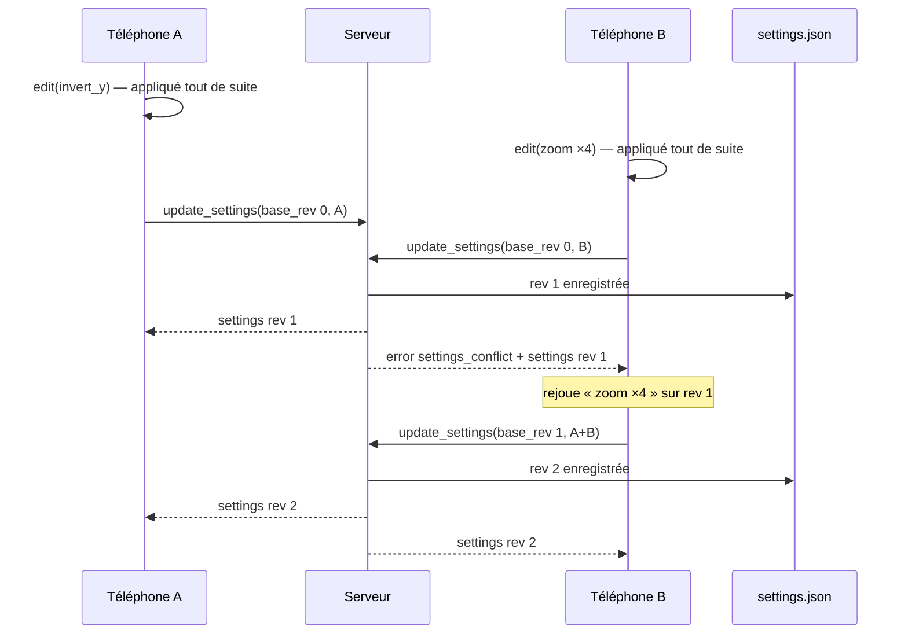

Les réglages sont validés et ramenés dans des plages sûres côté serveur (`Settings::sanitized`) : valeurs non finies remplacées par les valeurs par défaut.

## Protocole

| Direction | Canal | Contenu |
|---|---|---|
| téléphone → PC | JSON | `hello`, `pair`, `button`, `key_tap`, `key`, `modifier`, `text`, `clutch`, `recenter`, `magnifier`, `update_settings`, `ping` |
| téléphone → PC | binaire | `0x01` mouvement (7 × f32), `0x02` trackpad (2 × f32), `0x03` défilement (2 × f32), `0x04` accélération linéaire pour l'option « déplacements du téléphone » (4 × f32), little-endian |
| PC → téléphone | JSON | `paired`, `welcome`, `settings`, `magnifier_state`, `error`, `pong` |

Garanties de sécurité côté serveur :

- aucune commande n'est exécutée avant `hello` ou `pair` réussi ;
- un clic, une touche ou un modificateur maintenu est **relâché** quand le téléphone se déconnecte ;
- les doubles « appui » sont ignorés (seules les vraies transitions partent) ;
- taille de message limitée à 64 Ko, trames binaires invalides ignorées.

## Loupe intelligente

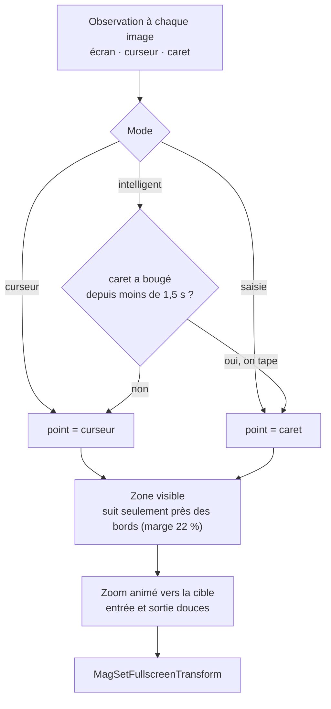

Limites connues : le caret n'est lisible que pour les applications Win32 classiques ; navigateurs et applications Electron retombent sur le curseur (UI Automation est prévue pour couvrir ces cas). La loupe agit sur l'écran principal.

## Choix techniques

| Sujet | Choix | Pourquoi |
|---|---|---|
| Client | PWA, Vite, Solid, TypeScript | iPhone sans compilation native, multiplateforme, 42 Ko de JS |
| Serveur | Rust, tokio, axum, rustls (ring) | binaire unique, faible latence, pas de dépendance C à compiler |
| Types partagés | `ts-rs` | une seule définition du protocole, vérifiée par la CI |
| Découverte | mDNS (`mdns-sd`) + QR | un navigateur ne peut pas scanner le réseau ; le nom `.local` reste stable si l'IP change |
| Injection | `SendInput` (crate `windows`) | API officielle, texte en Unicode (accents, emoji) |
| Tests | `cargo test`, Vitest, Playwright | cœur et sessions sans OS, client avec faux WebSocket |
