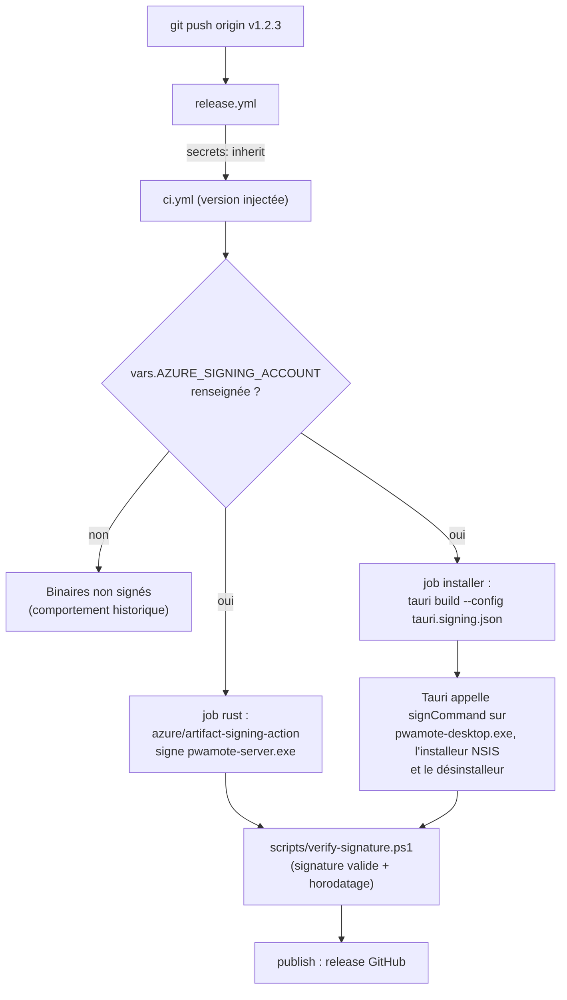

# Signature Windows (Authenticode)

Sans signature, Windows SmartScreen affiche « Windows a protégé votre ordinateur » et **Éditeur : inconnu** au premier lancement de l'installeur ou de la version sans installation téléchargés depuis GitHub. Une signature Authenticode remplace « inconnu » par le nom vérifié de l'éditeur, et sert de base à la réputation SmartScreen.

La CI de release sait signer avec **Azure Artifact Signing** (ex-Trusted Signing). Elle reste inactive tant que les variables ci-dessous ne sont pas renseignées : les releases sortent alors non signées, comme avant.

## Ce que fait la CI



- **Serveur seul** (`pwamote-server.exe`, artefact de CI, n'est plus publié en release) : signé par l'action officielle Microsoft juste après `cargo build --release`.
- **Application de bureau** : Tauri retouche le binaire pendant le bundling, une signature posée avant serait invalidée. On lui passe donc un `signCommand` (`artifact-signing-cli`, l'outil recommandé par la documentation Tauri) qu'il appelle lui-même pour l'exécutable, l'installeur et le désinstalleur. Ce même exécutable signé est publié tel quel comme version sans installation (`PwaMote_1.2.3_x64_portable.exe`).
- Horodatage RFC 3161 (`timestamp.acs.microsoft.com`) : les certificats Artifact Signing ne vivent que 3 jours, l'horodatage garde la signature valide ensuite.
- Le job échoue si une signature attendue est absente, invalide ou non horodatée.

## Activer la signature

1. **Compte Azure** avec un abonnement (paiement à l'usage), puis une ressource *Artifact Signing account* (offre Basic, environ 9,99 $/mois). Noter sa région : elle donne l'endpoint, par exemple `https://weu.codesigning.azure.net/` pour Europe Ouest.
2. **Validation d'identité** (*Identity validation*, type *Public Trust*) dans la ressource. Microsoft vérifie l'identité de l'éditeur ; le nom validé est celui qu'affichera Windows.
3. **Profil de certificat** *Public Trust* rattaché à cette identité.
4. **App Registration** dans Entra ID (ex-Azure AD) avec un *client secret*, et lui donner le rôle **Artifact Signing Certificate Profile Signer** sur le compte de signature.
5. Dans GitHub, *Settings › Secrets and variables › Actions* du dépôt :

| Type | Nom | Valeur |
| --- | --- | --- |
| Variable | `AZURE_SIGNING_ENDPOINT` | endpoint de la région, ex. `https://weu.codesigning.azure.net/` |
| Variable | `AZURE_SIGNING_ACCOUNT` | nom du compte Artifact Signing |
| Variable | `AZURE_SIGNING_PROFILE` | nom du profil de certificat |
| Secret | `AZURE_TENANT_ID` | ID du tenant Entra |
| Secret | `AZURE_CLIENT_ID` | ID d'application de l'App Registration |
| Secret | `AZURE_CLIENT_SECRET` | secret client (à renouveler avant expiration) |

La signature s'active à la release suivante (`AZURE_SIGNING_ACCOUNT` non vide). La retirer suffit pour revenir aux binaires non signés.

## Réputation SmartScreen

Depuis 2024, aucun certificat (pas même EV) ne supprime l'avertissement dès le premier jour : SmartScreen accorde sa confiance selon l'historique de téléchargements sans incident d'une même identité d'éditeur. Concrètement :

- les premières releases signées affichent encore l'écran bleu, mais avec le nom de l'éditeur au lieu de « inconnu » ;
- signer **toutes** les releases avec la **même identité** fait profiter les versions suivantes de la réputation accumulée ;
- en cas de détection abusive, un fichier peut être soumis à Microsoft pour analyse (portail *Submit a file for malware analysis*, catégorie développeur).

L'installation via le Microsoft Store (paquet MSIX re-signé par Microsoft) est la seule voie sans aucun avertissement.

## Vérifier localement

```powershell
./scripts/verify-signature.ps1 .\PwaMote_1.2.3_x64_portable.exe
# ou : clic droit › Propriétés › Signatures numériques
```
